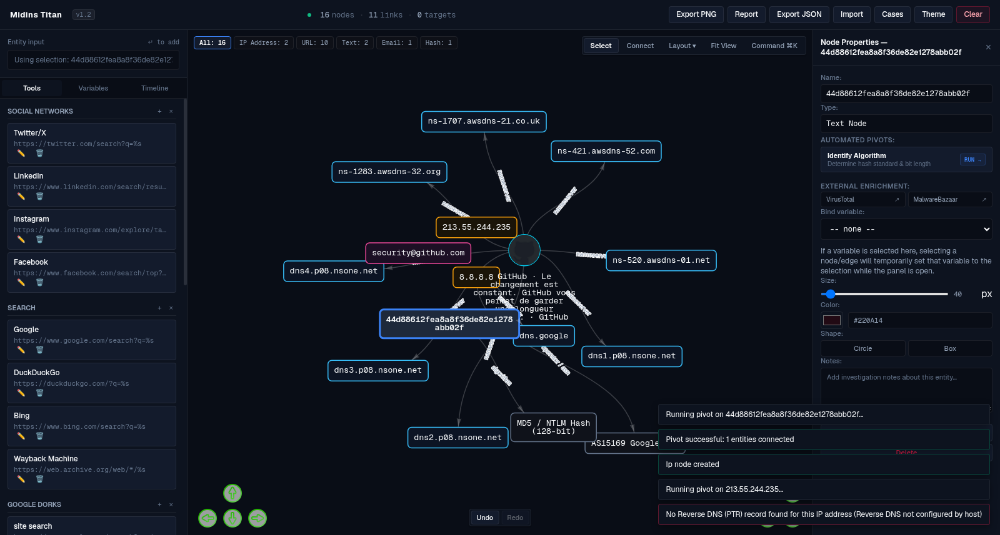

# 🛡️ MIDINS TITAN — Visual OSINT & Link Analysis Workbench


> **Related Tool:** Check out [Midins Decryptor](https://github.com/Med0-n/Midins-Decryptor) — Modular cryptographic & encoding analysis suite.

---

**MIDINS TITAN** is an ultra-fast, local-first visual OSINT investigation workbench and link-analysis graph tool. Built for cyber threat intelligence (CTI) analysts, incident responders, security researchers, and investigative journalists, Titan enables rapid digital infrastructure mapping and evidence correlation without leaking queries to third-party clouds or getting bogged down by bloated enterprise tools.

*“Focus on the investigation, not the tool.”*

---

## 📸 Interface Preview (V1.3.0)

<p align="center">
  
</p>

*Live interactive graph showing automated DNS, ASN, PTR, GeoIP, and Hash identification pivots with the architectural grid layout and audit timeline.*

---

## ⚡ What's New in Version 1.3.0

### 1. 🔬 Automated OSINT Pivoting & Deep Pivot Engine
Titan v1.3.0 introduces an integrated, privacy-focused transformation engine that performs local and DoH-based automated pivots without requiring paid API keys:

| Target Entity | Pivot Identifier | Output Node Type | Description |
|---|---|---|---|
| **IP Address** | `Location (GeoIP)` | `location` | City, region, country, and geographic coordinates |
| **IP Address** | `Operator & ASN` | `operator / asn` | Autonomous System Number (ASN) and network carrier |
| **IP Address** | `Reverse DNS (PTR)` | `reverse ptr` | Associated hostname via resilient 3-tier fallback |
| **IP Address** | `Netblock & Org` | `organization` | IP range, route allocation, and owning organization |
| **Domain / URL** | `IPv4 Addresses (A)` | `resolves to` | Forward IPv4 address mapping |
| **Domain / URL** | `IPv6 Addresses (AAAA)` | `ipv6` | Forward IPv6 address mapping |
| **Domain / URL** | `Mail Servers (MX)` | `mail server` | Authoritative incoming mail exchange servers |
| **Domain / URL** | `Name Servers (NS)` | `nameserver` | Authoritative DNS nameservers |
| **Domain / URL** | `Security & SPF (TXT)` | `txt record` | SPF, DMARC, DKIM, and site verification records |
| **Domain / URL** | `Subdomain Discovery` | `subdomain` | Probing common infrastructure subdomains (`api`, `vpn`, `mail`, etc.) |
| **Email Address** | `Extract Root Domain` | `domain` | Isolates and connects root organization domain |
| **Email Address** | `Mail Servers (MX)` | `mail server` | Resolves mail routing hosts for recipient domain |
| **Cryptographic Hash** | `Identify Algorithm` | `algorithm` | Classifies hash format (MD5, SHA-1, SHA-256, SHA-512) |

- **Deep Pivot (`Run All Pivots ⚡`)**: Trigger all applicable pivots concurrently with a single click (`Promise.allSettled`). Child nodes automatically expand radially with spring physics.
- **Resilient Reverse DNS**: Zero unhandled socket crashes (`[Errno 1] Unknown host` resolved through local socket + Cloudflare DoH PTR fallback).

### 2. ⏱️ Investigation Timeline & Audit Trail
- Real-time chronological event logging of every node creation, link connection, pivot execution, and tag change.
- Click any entry in the Timeline tab to instantly focus and zoom to that entity on the canvas.

### 3. ⌨️ Command Palette (`⌘K` / `Ctrl+K`)
- Omnipresent modal search across all graph entities, targets, labels, and notes.
- Quick action runner for rapid keyboard-driven workflows.

### 4. 🎛️ Canvas Filter HUD
- Real-time pill counter bar at the top of the canvas (`All`, `IP`, `Domain`, `Location`, `ASN`, `Email`, etc.).
- Click any filter pill to immediately dim unrelated nodes and isolate specific entity categories.

### 5. 📐 Dynamic Layout Switcher
Switch graph layouts on the fly without losing node associations:
- **Organic Physics**: Force-directed simulation with repulsive node charge.
- **Hierarchical (Top-Down)**: Directed tree structure ideal for infrastructure hierarchies.
- **Horizontal (Left-Right)**: Linear progression graph for timeline or attack path mapping.
- **Radial Cluster**: Clustered hub-and-spoke layout centered on seed targets.

### 6. 🔗 1-Click Threat Intel Enrichment
Instant external pivot shortcuts directly inside the entity inspector:
- **IPs**: VirusTotal, Shodan, AbuseIPDB, BGPView
- **Domains**: urlscan.io, crt.sh, Wayback Machine, VirusTotal
- **Hashes**: VirusTotal Search, MalwareBazaar

### 7. 🎨 Strict "Unslop" Visual Craft
- Clean architectural hairline grid replacing dated generic radial dot patterns.
- High-contrast, sharp nodes without blurry canvas shadows for maximum legibility.
- Polished typography using the Geist geometric sans font stack.
- Completely localized into 100% English.

---

## 📂 Core Features

### 📁 Case Management & Persistence
- **Local Storage Engine**: Save, rename, load, and switch between multiple investigation cases.
- **State Integrity**: All node positions, custom colors, status tags, notes, and relationship labels are saved automatically as you drag or modify entities.

### 🧠 Smart Input Parser
Drop any piece of intelligence into the search bar: Titan automatically detects the entity type (IPv4, IPv6, Domain, URL, Email, Phone, Hash, or Plain Text) and assigns the appropriate color and typography.

### 📸 Export & Reporting
- **PNG Graph Export**: High-resolution image capture of your current canvas for presentations and case files.
- **Markdown Investigation Report**: One-click generation of structured `.md` case reports organized by status, tags, relations, and analyst notes.
- **JSON Import / Export**: Complete portability of graph datasets and coordinate matrices.

### 🏷️ Status Tags & Analyst Notes
- Fast categorization with status tags: 🎯 **Target**, ⚠️ **Suspect**, 🔍 **To Verify**, ✅ **Confirmed**.
- Dedicated analyst note pads attached to each node, exported seamlessly into final reports.

---

## 🚀 Quick Start & Installation

### Prerequisites
- Python 3.9 or higher
- Modern web browser (Chrome, Chromium, Firefox, Brave, Safari)

### 1. Clone or Download
```bash
git clone https://github.com/Med0-n/Midins_Titan-Osint_Tool.git
cd Midins_Titan-Osint_Tool
```

### 2. Install Dependencies

**Linux / macOS:**
```bash
chmod +x install.sh
./install.sh
```

**Windows:**
Double-click `install.bat` (or run in Command Prompt / PowerShell):
```cmd
install.bat
```

**Manual / Virtualenv:**
```bash
python3 -m venv venv
source venv/bin/activate  # On Windows: venv\Scripts\activate
pip install -r requirements.txt
```

### 3. Launch the Workbench

**Linux / macOS:**
```bash
chmod +x launch.sh
./launch.sh
```

**Windows:**
Double-click `launch.bat`

**Manual:**
```bash
python3 app.py
```
Open your browser at **http://127.0.0.1:5000** (opened automatically by the launcher scripts).

---

## ⌨️ Keyboard Shortcuts

| Shortcut | Context | Action |
|---|---|---|
| `⌘K` / `Ctrl+K` | Global | Open Command Palette / Global Entity Search |
| `Ctrl+F` | Canvas | Search & cycle through nodes on graph |
| `Enter` | Search Bar | Add input as a typed node on canvas |
| `Delete` / `Backspace` | Canvas | Delete selected node or connection |
| `Ctrl+Z` | Canvas | Undo last graph modification |
| `Ctrl+Y` / `Ctrl+Shift+Z` | Canvas | Redo graph modification |
| `Double-Click` | Node | Copy entity value / URL to clipboard |
| `Right-Click` | Node | Open Context Pivot & Action Menu |
| `Esc` | Modals | Close Command Palette / Dialogs |

---

## 🛡️ Privacy & Technical Architecture

Midins Titan is architected from the ground up to respect investigator privacy and operational security (OPSEC):
- **100% Localhost Execution**: Runs completely on `127.0.0.1`. No user telemetry, analytics scripts, or cloud phone-home calls.
- **Encrypted DNS-over-HTTPS (DoH)**: Domain and PTR lookups leverage secure DoH queries with fallback to local resolver sockets, preventing DNS eavesdropping by upstream ISPs.
- **No Third-Party Credentials Required**: All core pivots operate without exposing personal API keys or account identifiers.

---

## 📜 License & Credits

- **Author:** [Med0](https://github.com/Med0-n)
- **License:** [Creative Commons Attribution-ShareAlike 4.0 International (CC BY-SA 4.0)](https://creativecommons.org/licenses/by-sa/4.0/)
- **MIDINS TITAN:** *Multimedia Intelligence & Digital Investigation Network System.*
